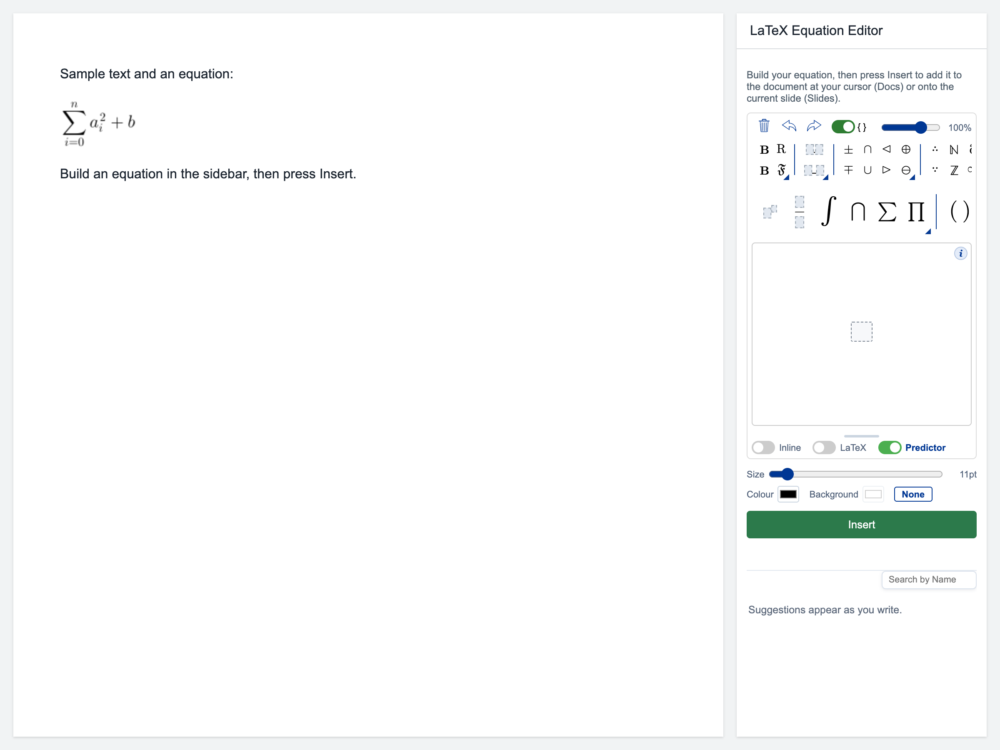

# fxEditor for Google Docs and Slides

The fxEditor add-on for Google Docs and Google Slides adds **Insert equation...** to the
Extensions menu. It opens fxEditor, CodeCogs' equation editor - a toolbar of symbols and
structures, a LaTeX view and a rendered maths view - in a sidebar beside your document. Press
**Insert** and the equation is placed at the cursor (Docs) or on the current slide (Slides).

Docs and Slides have no toolbar a third party can add a button to, so the add-on is a menu item
and a sidebar rather than an **fx** button. And they have no way for an add-on to insert MathML
or live LaTeX, so the equation goes in as an image: a PNG drawn at the moment you insert it, so
the document does not depend on our service afterwards. The equation's LaTeX is kept in the
image's alt text, for screen readers. An inserted equation cannot be reopened in the editor -
to change one, build it again in the sidebar and insert it in place of the old one.

In Google Workspace the add-on is called **LaTeX Equation Editor - fxEditor**. It is an Apps
Script project, not an npm package.

**Status: preview.** The add-on is not yet listed on the Google Workspace Marketplace. Deploy
your own copy from this repository, as described below. It has not yet been run end to end in a
real Google account - the screenshot below is the sidebar in our stand-in preview
(`example.html`), not in Google Docs itself.

## Screenshot



*The equation editor sidebar beside a document.*

## Links

- Documentation and live demo: https://fxplugins.codecogs.com/docs/google-docs.html
- Customise and download: https://fxplugins.codecogs.com/docs/google-docs.html#customise
- All fxEditor plugins: https://fxplugins.codecogs.com
- fxEditor: https://fxeditor.codecogs.com

## Installing from git

Deploy your own copy - for example, as an add-on private to your Google Workspace domain - with
Google's [`clasp`](https://github.com/google/clasp) tool:

```bash
git clone https://github.com/willzyba/google_workspace.git
cd google_workspace
npm install -g @google/clasp
clasp login
clasp create --type docs --title "LaTeX Equation Editor - fxEditor" --rootDir src
cp appsscript.json src/appsscript.json
clasp push
```

`clasp` pushes only what is in `src/`, and `clasp create` puts a default manifest there, so the
`cp` replaces it with this repository's `appsscript.json` - the OAuth scopes and the Docs and
Slides add-on registration. (`--type docs` only affects clasp's own scaffold; the manifest's
`addOns.slides` section is what makes the add-on work in Slides too.)

Then set its Script properties - in the Apps Script editor, *Project Settings > Script
Properties* - with at least your licence key (see [Licence key](#licence-key)).

Then, from the Apps Script editor:

1. *Deploy > Test deployments* to try it in your own Docs and Slides.
2. *Deploy > New deployment > Editor Add-on* once it is working. Before anyone outside your own
   organisation can install it, the Google Cloud project it runs under has to complete Google's
   OAuth verification.
3. To list it on the Google Workspace Marketplace for anyone to find, you also need a
   Marketplace SDK configuration and store listing.

## Licence key

Equations are rendered by fxTeX Pro, which needs a licence key for your domain.

Get your licence key from https://fxeditor.codecogs.com/purchase.

The key goes in the Script property `EQNEDITOR_LICENCE`. If you are not sure which domain to
register for an add-on, [contact us](https://fxeditor.codecogs.com/contact).

### Script properties

| Script property | Default | Meaning |
|---|---|---|
| `EQNEDITOR_LICENCE` | *(empty)* | Your fxEditor licence key. Required. |
| `EQNEDITOR_DESIGN` | *(empty)* | The editor's look, as JSON: dialog width, height and scale, toolbar panels and size, colour, equation and markup sizes, undo/redo. Build one in [Customise and download](https://fxplugins.codecogs.com/docs/google-docs.html#customise) - `design.json` in the download. JSON that does not parse is ignored. |
| `EQNEDITOR_SERVER` | `https://fxtex.codecogs.com` | Where the equation editor is loaded from, as a URL. |
| `EQNEDITOR_RENDER_URL` | `https://fxtex.codecogs.com` | The service that draws the images. |

## Licence

Copyright (c) 2026 CodeCogs, Zyba Ltd.

The add-on is released under the MIT licence - see
[`LICENSE`](https://github.com/willzyba/google_workspace/blob/main/LICENSE). fxEditor and
fxTeX Pro need their own licence key, as above.

## How it works

```
appsscript.json      Manifest - OAuth scopes, Docs/Slides add-on registration.
src/Code.gs          Server side: the menu item, the sidebar, the configuration and the insert.
src/Sidebar.html     The sidebar: the equation editor, loaded the same way every other fxEditor
                     plugin loads it, plus an Insert button.
example.html         A preview of the sidebar outside Google, beside a stand-in document.
```

1. The sidebar, running in Apps Script's sandboxed frame, reads its configuration from
   `getConfig()` in `Code.gs` and loads `fxeditor.api.min.js` and `fxeditor.css` from
   `EQNEDITOR_SERVER` (`https://fxtex.codecogs.com`).
2. Pressing **Insert** takes the rendering URL of the current equation from the equation
   editor itself (so the add-on never builds or escapes that URL on its own) and calls
   `insertEquation()` in `Code.gs`.
3. `insertEquation()` runs on Google's servers: it fetches the PNG with `UrlFetchApp` and inserts
   it at the cursor (Docs) or onto the current slide (Slides), sized from the resolution it was
   rendered at.

Fetching on the server, rather than in the sidebar, means the rendering service only needs to be
reachable from Google's servers, not from inside the sidebar's sandboxed frame.

### Known gaps

- **Not yet run in a real Google account** - see *Status* above.
- **No automated tests.** Apps Script has its own options (`clasp run` against a test
  deployment, or mocks for the DocumentApp/SlidesApp/UrlFetchApp globals); neither is set up.
- **Slides with nothing selected** - `insertEquation()` falls back to the first slide; not yet
  tried against a real Slides selection.
- **No OAuth verification** - until Google has reviewed the Cloud project it runs under, the
  add-on can only be installed by the developer's own account or a test group.
